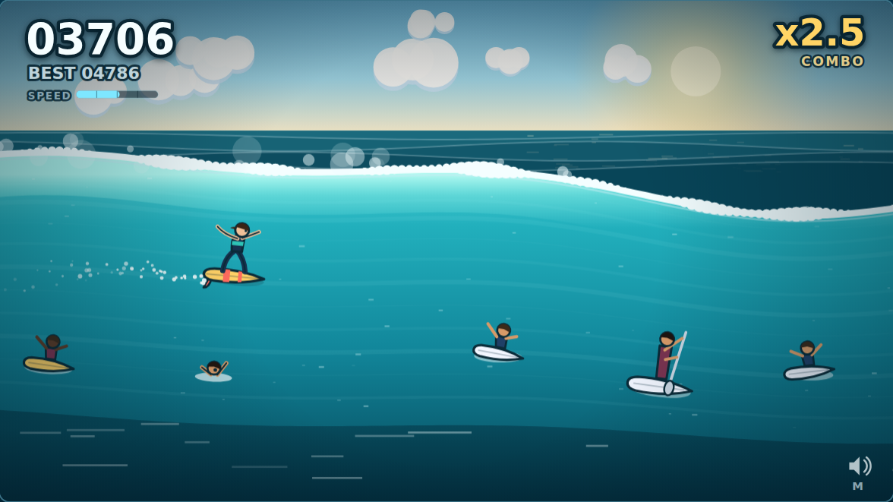

# Surf's Up

**[▶ Play it](https://blakeworsley.github.io/surfs-up/)**

An endless surf game in a single HTML canvas. Ride the face of a wave, pick your
line through the crowd, and boost off the lip when the water ahead is clear.



## How to play

| | |
|---|---|
| <kbd>↑</kbd> <kbd>↓</kbd> | Climb toward the lip or drop toward the trough |
| <kbd>Space</kbd> | Launch off the lip — hold it in the air for a grab |
| <kbd>←</kbd> <kbd>→</kbd> | Spin while airborne · trim your speed while riding |
| <kbd>P</kbd> / <kbd>Esc</kbd> | Pause |
| <kbd>M</kbd> | Mute |

On a phone the controls appear on screen: ▲ ▼ to move, **AIR** to launch, and
↺ ↻ to spin once you're off the lip.

### The idea

Height on the wave is the whole game.

- **Drop low** and you go faster — more distance, more points, less time to
  react to whoever is floating in front of you.
- **Ride high** and you slow down, but you're set up to launch.
- **Hit Space near the lip** and you go airborne. Spin with ← / →, hold Space to
  grab, and bring the board back around to *facing forward* before you land.
  Land sideways and you eat it. There's a dial next to you in the air showing
  your rotation and the window you need to be inside — green means you're good.
- Too low to launch? Space becomes a **pump** for a burst of speed instead, so
  the button is never dead.

Everyone in the water is an obstacle: swimmers, kooks, bodyboarders,
longboarders, stand-up paddlers, and paddlers who climb up the face and into
your line while you're trying to get past them. Once you're far enough out,
seagulls start showing up in the air — the only thing that can end an air.

Every so often the wave stands up and throws a **barrel section**. The crowd
clears out, the lip pitches over you, and points pour in for as long as you can
hold the pocket. You can't launch inside one — there's a roof.

### Scoring

Distance ticks over constantly. On top of that:

| | |
|---|---|
| Air | Hang time, plus a bonus for a genuinely big one |
| 360 / 720 / 1080 / 1440 | Every full rotation is worth more than the last |
| Grab | Points per second held — at the cost of spinning slower |
| Barrel | Points per second in the tube, doubled deep in the pocket |
| Near miss | A little something for threading the gap |

Each trick you land raises a combo multiplier that rides with you until you
wipe out. Your best score is kept in the browser.

## Running it

No dependencies, no build step, no bundler. ES modules straight from disk.

```
git clone git@github.com:blakeworsley/surfs-up.git
cd surfs-up
npm start          # http://localhost:8080
```

`npm start` runs a small static file server from `tools/`. Anything that can
serve a directory over HTTP works just as well — the game needs a server only
because browsers won't load ES modules over `file://`.

```
npm test                      # 80 tests, node's built-in runner
node tools/simulate.js 200    # play 200 bot runs, print the difficulty curve
```

`tools/simulate.js` is how the balance was tuned: it plays the real game
headless with a simple bot and reports the score and survival-time
distribution, so the difficulty curve is measured rather than guessed.

## How it's built

```
index.html
css/style.css
src/
  config.js        every tunable number, in one place
  wave.js          wave geometry and barrel sections
  surfer.js        player physics: riding, air, rotation, landings
  obstacles.js     the cast, the spawner, and its fairness rules
  scoring.js       trick naming, points, combos, personal best
  particles.js     spray, foam, wake, floating text
  input.js         keyboard and touch, unified into one intent object
  audio.js         every sound, synthesised at runtime
  game.js          state machine tying it together
  main.js          canvas setup and the loop
  render/          scene, wave, characters, surfer, HUD
  util/            math, seeded rng, safe storage
test/              unit tests for the pure logic
tools/             dev server and the balance harness
```

A few decisions worth knowing about:

**Everything is drawn with paths.** There isn't a sprite sheet in the repo. The
sky, the wave, the surfer and every character in the water are canvas paths and
gradients, so it stays sharp at any resolution and there are no assets to load.

**Position on the wave is normalised, not absolute.** The surfer and every
obstacle store a height `h` from 0 (trough) to 1 (lip), and the renderer maps
that onto the wave's current shape. The wave can swell and wobble however it
likes without a single line of gameplay code caring.

**The spawner can't wall the wave off.** Before an obstacle is placed, the
spawner checks the largest gap left in the face and refuses any arrangement
that would leave you nowhere to go, or that you couldn't react to at the
current speed. Both rules are unit tested.

**The sound is synthesised.** Water is filtered white noise whose cutoff tracks
your speed; the trick stings are short oscillator envelopes on a pentatonic
scale so combos climb instead of clashing. No audio files.

**The game logic runs headless.** `Game` has no DOM dependency except `render`,
which is why the whole thing — physics, spawning, scoring, barrels — can be
tested and simulated in Node.

## History

The original Surf's Up was built in 2016 by
[Blake Worsley](https://github.com/blakeworsley) and MaryJane Valade as a paired
project in Module 1 of the Turing School's Front-End Engineering program: a
Chrome-dinosaur-style game where a surfer jumped over rocks.

This is a rewrite. The wave became something you ride up and down rather than a
floor you hop along, the rocks became people, and the jump became an aerial you
have to land. The original is still in the git history, where it should be.

## License

[MIT](LICENSE).
